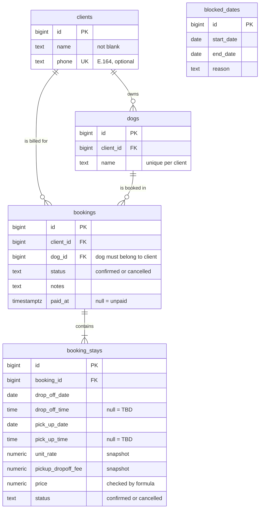

# Database schema

Current as of `V1__initial_schema.sql`. The migrations in `src/main/resources/db/migration/` are the source of truth; update this diagram in the same change as any new migration.

Every table has `created_at`; every table except `blocked_dates` also has `updated_at`.

## What each table is for

| Table | One row means… | Used for |
|---|---|---|
| `clients` | One person you bill | Client lookup (including by phone for WhatsApp), earnings per client |
| `dogs` | One dog and its owner | Picking a dog on the booking form, history per dog |
| `bookings` | One visit for one dog, paid and confirmed once | Creating, paying, cancelling a whole visit, one confirmation |
| `booking_stays` | One date range in a booking, with the price charged | Adding or cancelling single days, totals, earnings reports |
| `blocked_dates` | A range when you're unavailable | Warning (never blocking) when a stay overlaps |

## Derived, not stored

- **Booking total:** sum of `price` over confirmed stays.
- **Service type:** `pick_up_date > drop_off_date` means Boarding, otherwise Day Care. Calculated in the API, in one place.

Rules that span several rows ("a booking has at least one stay", "cancelling the last stay cancels the booking") are enforced in the API.
